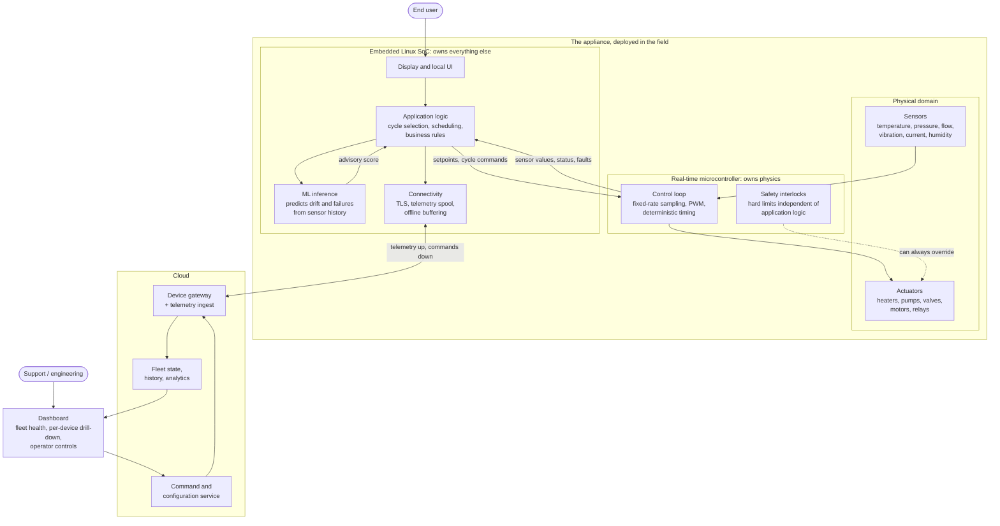
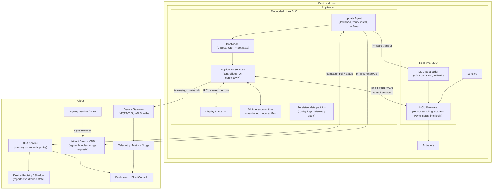
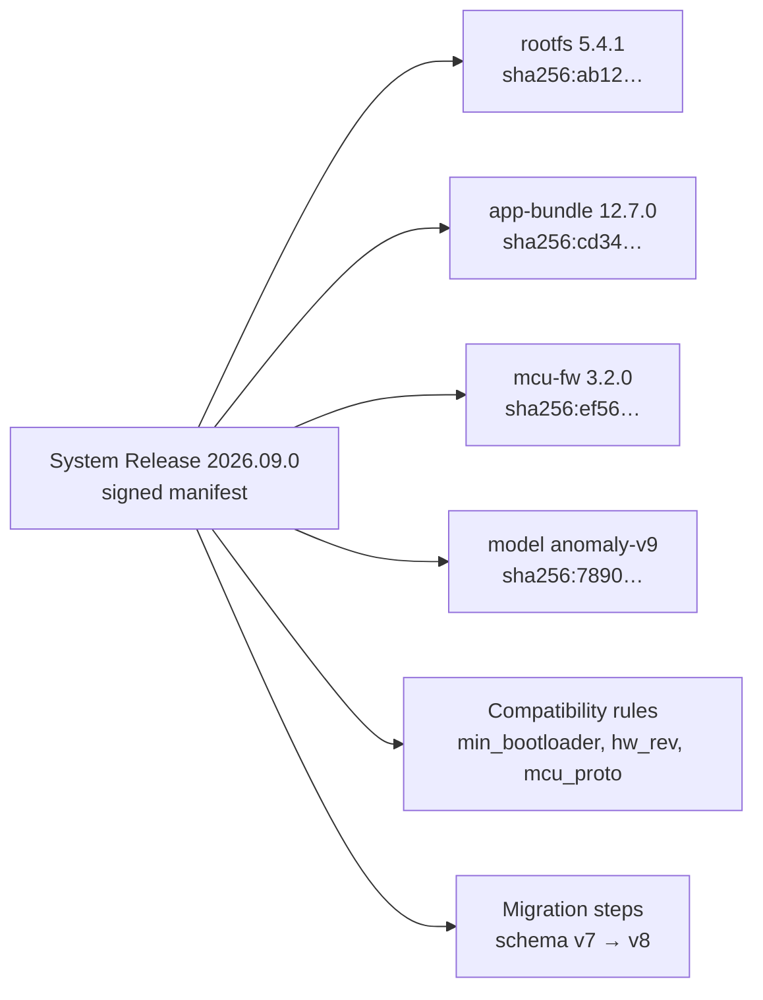
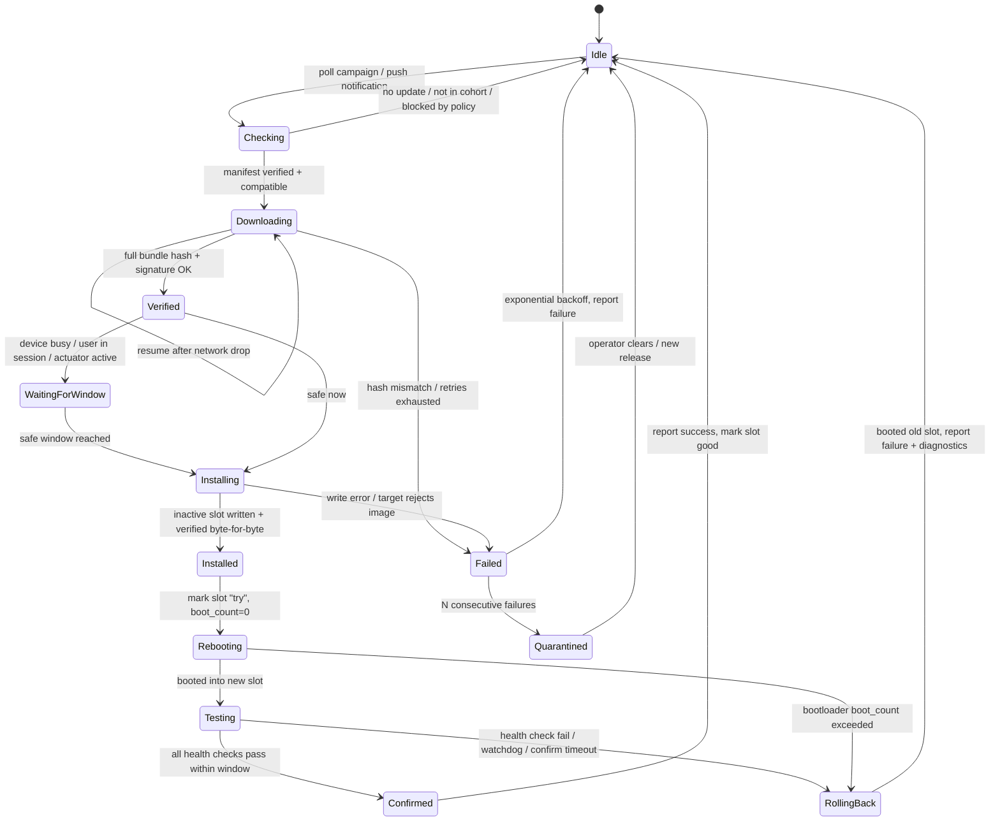
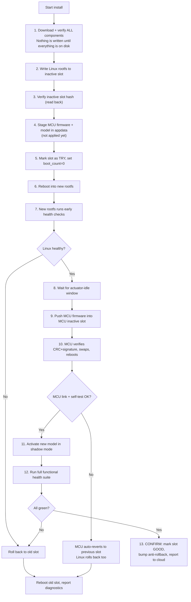
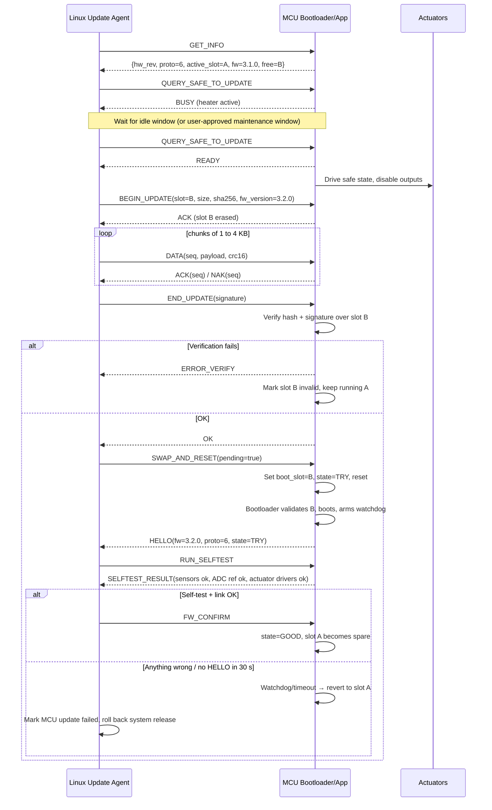
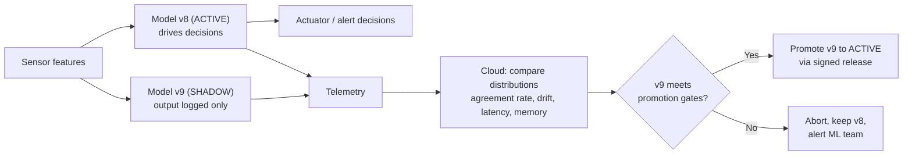
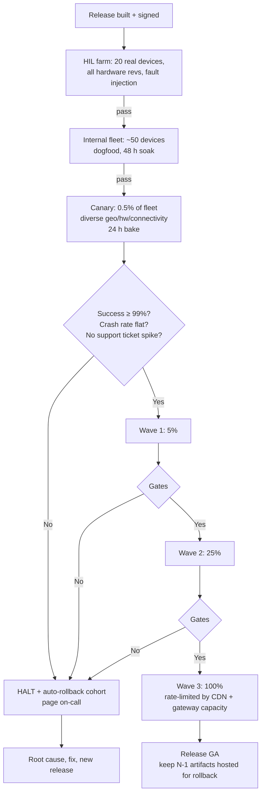
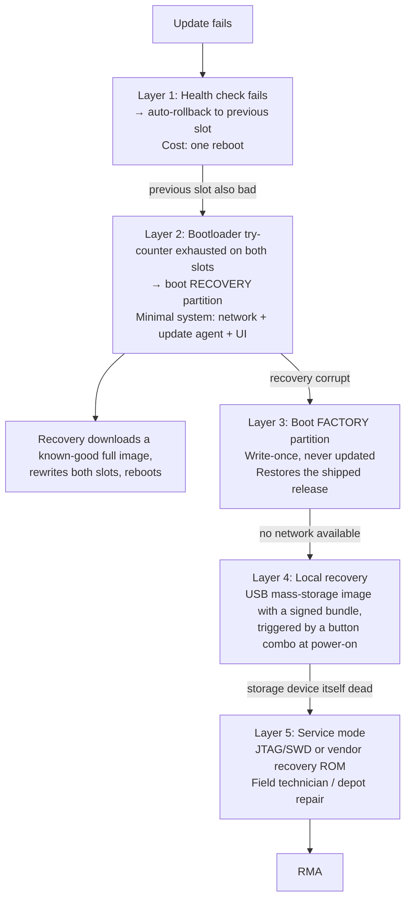

# Production-Grade, Fail-Safe OTA for a Multi-Processor IoT Appliance

A complete blueprint for updating a fleet of connected appliances that contain an embedded
Linux SoC, a real-time microcontroller, an on-device ML model, a display/UI, plus the cloud
services and dashboards that talk to them.

This document is opinionated. It describes what a system that survives contact with 100,000
devices in the field actually looks like, and it enumerates the failure modes that will
eventually happen to you, with a concrete mitigation for each one.

---

## Table of Contents

[The Product We Are Updating](#the-product-we-are-updating)

1. [The System Under Update](#1-the-system-under-update)
2. [Non-Negotiable Design Principles](#2-non-negotiable-design-principles)
3. [The Release Model: Bundles, Manifests, Compatibility](#3-the-release-model-bundles-manifests-compatibility)
4. [Device-Side Architecture](#4-device-side-architecture)
5. [Updating Embedded Linux (A/B Root Filesystems)](#5-updating-embedded-linux-ab-root-filesystems)
6. [Updating the Microcontroller Firmware](#6-updating-the-microcontroller-firmware)
7. [Updating the ML Model](#7-updating-the-ml-model)
8. [Updating Cloud, API and Dashboard](#8-updating-cloud-api-and-dashboard)
9. [Health Gating and the Confirmation Contract](#9-health-gating-and-the-confirmation-contract)
10. [Rollout Orchestration: Cohorts, Canaries, Circuit Breakers](#10-rollout-orchestration-cohorts-canaries-circuit-breakers)
11. [Security and Threat Model](#11-security-and-threat-model)
12. [Failure Mode and Effects Analysis (the big table)](#12-failure-mode-and-effects-analysis)
13. [Deadlock, Brick and Bootloop Escape Hatches](#13-deadlock-brick-and-bootloop-escape-hatches)
14. [Observability: What You Must Measure](#14-observability-what-you-must-measure)
15. [Testing: HIL Farm, Fault Injection, Chaos](#15-testing-hil-farm-fault-injection-chaos)
16. [Operational Runbooks](#16-operational-runbooks)
17. [Reference Technology Stack](#17-reference-technology-stack)
18. [Implementation Checklist](#18-implementation-checklist)

---

## The Product We Are Updating

Before any of the update machinery makes sense, it helps to be concrete about the product itself.

The product is a connected appliance. Picture something roughly the size of a small washing
machine or a commercial coffee machine, installed in homes or small businesses, plugged into
mains power and joined to the customer's Wi-Fi. It runs jobs or cycles on behalf of a user, it
reads its physical environment through a set of sensors, and it acts on that environment through
heaters, pumps, valves, motors or relays. There is no camera anywhere in the product, so every
input is a scalar or a low-rate signal rather than a video stream. A screen on the front panel
lets the user start a job, watch its progress and change settings. Tens of thousands of these
units are already deployed, and the number grows every quarter.

Inside the enclosure there are two processors with very different jobs.

The **real-time microcontroller** owns physics. It samples the sensors at a fixed rate, drives
the actuators with precise timing, and enforces the safety interlocks that must hold whatever
else goes wrong. It has no operating system worth speaking of, its timing is deterministic, and
it is the only part of the system trusted to decide that a heater must switch off right now. Its
software is a firmware binary.

The **embedded Linux SoC** owns everything else. It runs the application logic that decides what
cycle to execute, renders the user interface on the display, holds the connection to the cloud,
buffers telemetry while offline, and hosts the machine learning model. It talks to the
microcontroller over a serial link with a framed protocol, sending setpoints down and receiving
sensor readings and status up. Its software is a Linux root filesystem plus a set of
applications.

The **machine learning model** is small and runs on the Linux side. It consumes recent sensor
values and predicts simple things, such as whether a component is drifting out of tolerance or
whether the current cycle is likely to fail. It produces a score. It never commands an actuator
directly, because a statistical model has no business driving physical hardware. Its software is
a model file plus the metadata describing how the model expects to be fed.

Outside the box, the **cloud** terminates the device connections, ingests telemetry, stores fleet
state and sends commands back down. The **dashboard** sits on top of that, showing engineering
and support teams what the fleet is doing and giving operators the controls to act on it.



Four pieces of software are therefore in the field at once, and each has its own update story.
The Linux root filesystem and applications are large and change often. The microcontroller
firmware is small, changes rarely, and carries physical risk when it changes. The ML model is
tiny, changes on its own cadence driven by data rather than features, and fails silently rather
than loudly. The cloud and dashboard change constantly and reach every device at once.

Devices are online most of the time but not all of the time. Wi-Fi drops, routers reboot,
customers go on holiday and unplug the appliance, and some units sit behind captive portals or
corporate proxies that behave badly. An update system that assumes a stable connection will work
in the lab and fail in the field.

The rest of this document is about how to change all four of those pieces of software, safely,
across the whole fleet, without ever producing a device that cannot be recovered remotely.

---

## 1. The System Under Update

The same product, viewed through the lens of what can be updated and what happens when an update
goes wrong.

The appliance is not one computer. It is a **distributed system in a plastic box**. Every box in
the field is a separate availability domain that you cannot SSH into.



### The five update domains

| # | Domain | Update unit | Failure blast radius | Rollback cost |
|---|--------|-------------|----------------------|---------------|
| 1 | Linux OS + rootfs | A/B rootfs image | Whole device offline | Cheap (reboot to other slot) |
| 2 | Applications / containers | OCI images or app partition | Device degraded | Cheap |
| 3 | MCU firmware | Signed binary into MCU slot | **Physical safety, actuator control** | Medium (MCU reboot, ~seconds of blind time) |
| 4 | ML model | Model file + metadata | Bad predictions, silent | Cheap (swap file) |
| 5 | Cloud/API/Dashboard | Container deploy | **Whole fleet at once** | Cheap but fleet-wide |

> **The asymmetry that defines the design:** the cloud is the easiest thing to update and the
> most dangerous, because a bad cloud deploy hits 100% of devices in 30 seconds. The MCU is the
> hardest to update and the most physically dangerous. Design accordingly.

---

## 2. Non-Negotiable Design Principles

**Every update is atomic and transactional.** There is no state in which the device is halfway
updated. Either the new version is fully committed or the old one is still running, and nothing
in between is ever observable from outside.

**Power can be cut at any instruction.** Assume a user unplugs the appliance in the middle of a
flash write. The device must still boot afterwards. Always.

**Nothing installs without cryptographic verification.** The signature is checked before install,
the hash is re-checked once the write lands, and the bootloader verifies the image again at boot.
Three checks at three different moments, because each one catches a different class of fault.

**The device is the final authority on its own health.** The cloud proposes and the device
disposes. A device has to be able to reject an update and roll itself back with zero cloud
contact, because the cloud is frequently the thing that is broken.

**Rollback is a first-class feature rather than an emergency procedure.** It runs in CI on every
release, exercised exactly the way the forward path is.

**Update the system rather than the components.** Devices run a *system release*, which is a
pinned tuple of rootfs, applications, MCU firmware and model. You ship tuples, never loose files.

**Never trust "the update finished" as a success signal.** Success means the device passed a
functional health check after reboot and then confirmed itself.

**Downgrade must be possible but never automatic across a security boundary.** Anti-rollback
counters block forced downgrade attacks, while a signed operator override handles the legitimate
case where you genuinely need to go backwards.

**Bandwidth is expensive and connectivity is flaky.** Differential updates, resumable downloads
and randomised jitter are requirements rather than optimisations.

**The update path must be simpler than the thing it updates.** The update agent, the bootloader
and the recovery path carry the highest assurance requirements in the product. Keep them small,
keep them boring and change them rarely.

---

## 3. The Release Model: Bundles, Manifests, Compatibility

### 3.1 System release

A **system release** is an immutable, signed manifest that names exact versions of every
component and declares the compatibility constraints between them.



### 3.2 Manifest example

```json
{
  "schema": 2,
  "release_id": "2026.09.0",
  "created_at": "2026-09-01T10:00:00Z",
  "compatible_hardware": ["APPL-A-rev3", "APPL-A-rev4"],
  "requires": {
    "min_bootloader_version": "2.1.0",
    "min_current_release": "2026.05.0",
    "mcu_protocol_range": [4, 6]
  },
  "anti_rollback_index": 17,
  "components": [
    {
      "name": "rootfs",
      "version": "5.4.1",
      "type": "raw-image",
      "target": "slot",
      "size": 412000000,
      "sha256": "ab12…",
      "delta_from": { "5.4.0": { "url": "…/rootfs-5.4.0-5.4.1.xdelta", "sha256": "…" } },
      "install_order": 20,
      "requires_reboot": true
    },
    {
      "name": "mcu-fw",
      "version": "3.2.0",
      "type": "mcu-binary",
      "protocol_version": 6,
      "sha256": "ef56…",
      "install_order": 30,
      "install_when": "actuators_idle",
      "requires_reboot": false
    },
    {
      "name": "ml-model",
      "version": "anomaly-v9",
      "type": "model",
      "runtime": "tflite>=2.14",
      "input_schema_hash": "9f2c…",
      "sha256": "7890…",
      "install_order": 40,
      "shadow_eval_hours": 72
    }
  ],
  "health_checks": ["boot_ok", "mcu_link_ok", "sensors_ok", "cloud_ok", "ui_ok", "model_ok"],
  "confirm_window_seconds": 900,
  "signature": {
    "alg": "ed25519",
    "key_id": "release-2026-Q3",
    "value": "…"
  }
}
```

### 3.3 Version compatibility is a matrix, not a line

You will eventually have devices on 8 different releases simultaneously. Every cloud API and
every MCU protocol change must be evaluated against **the oldest release still in the field**,
not against `main`.

Four rules keep this tractable. The **MCU to Linux protocol** is version-negotiated on the link
handshake: Linux advertises a supported range `[proto_min, proto_max]`, the MCU announces its own
version, and the pair settles on the highest number both understand. Never ship a Linux
application that speaks only the newest protocol.

The **device to cloud API** accepts additive changes only within a major version. Devices send
their release ID on every connection so the gateway can shim behaviour for older builds.

The **model to feature extractor** binding is enforced by the `input_schema_hash` carried in the
model artifact. The runtime refuses to load a model whose schema hash does not match the feature
extractor it is paired with, which removes an entire class of silent corruption bugs.

**Stepping stones** handle the long tail. If `2026.09.0` cannot be applied directly on top of
`2025.02.0`, the OTA service computes an upgrade path such as `2025.02 -> 2025.11 -> 2026.09` and
drives the device through each hop. Never let a device work this path out for itself.

---

## 4. Device-Side Architecture

### 4.1 Partition layout (Linux)

```
+---------------------------+
| Bootloader (U-Boot) + env |  redundant env copies, A/B
+---------------------------+
| Bootloader env backup     |
+---------------------------+
| rootfs_A   (read-only)    |  dm-verity protected
+---------------------------+
| rootfs_B   (read-only)    |  dm-verity protected
+---------------------------+
| appdata    (read-write)   |  ext4, journaled, survives updates
+---------------------------+
| models     (read-write)   |  A/B model dirs + active symlink
+---------------------------+
| mcu_fw     (read-write)   |  staging area for MCU images
+---------------------------+
| recovery   (read-only)    |  minimal initramfs + update agent
+---------------------------+
| factory    (read-only)    |  last-resort known-good, never written
+---------------------------+
```

Root filesystems are read-only and integrity-protected with dm-verity, so "the filesystem got
corrupted by a bad flash sector" becomes a detectable and recoverable event instead of a mystery
crash three weeks later. All mutable state lives in `appdata`, and if you cannot factory-reset a
device by wiping exactly one partition then your layout is wrong. The `factory` partition is
written once during manufacturing and never again. It is the floor you cannot fall through.

### 4.2 The update agent state machine



### 4.3 Install ordering inside one transaction

Order matters enormously. The rule: **install the hardest-to-reverse thing when everything else
is already known good.**



> **Why the reboot happens before the MCU update:** rolling back Linux is free. Rolling back the
> MCU is not. If you update the MCU first and the Linux image turns out to be broken, you are
> now running old Linux against new MCU firmware, a combination nobody has ever tested. Prove
> Linux boots first, *then* touch the MCU.

---

## 5. Updating Embedded Linux (A/B Root Filesystems)

### 5.1 Why A/B and not in-place

| Approach | Power-fail safe | Rollback | Storage cost | Verdict |
|---|---|---|---|---|
| Package manager (apt/opkg) in place | ❌ | ❌ | Low | Never for fleets |
| Single image + recovery partition | ⚠️ (recovery must work) | Slow | Medium | Acceptable minimum |
| **A/B slots (dual-rootfs)** | ✅ | Instant | 2× rootfs | **Recommended** |
| A/B + delta | ✅ | Instant | 2× rootfs | Recommended at scale |
| OSTree / atomic tree | ✅ | Instant | ~1.3× | Good for large, similar images |

### 5.2 Bootloader responsibilities

The bootloader is the only component that can save you from a bad rootfs. Its logic must be
trivial enough to be reviewed line by line.

```c
/* Pseudocode: U-Boot boot slot selection, executed every boot */
slot = env.boot_order[0];               /* e.g. "A" */

for (i = 0; i < NUM_SLOTS; i++) {
    slot = env.boot_order[i];

    if (env.slot[slot].state == BAD)          continue;
    if (env.slot[slot].tries_remaining == 0) { env.slot[slot].state = BAD; continue; }

    if (!verify_signature(slot))         { env.slot[slot].state = BAD; continue; }

    if (env.slot[slot].state == TRY) {
        env.slot[slot].tries_remaining--;     /* decrement BEFORE booting */
        env_save_atomic();                    /* redundant env copies, CRC'd */
    }
    boot(slot);                               /* does not return */
}

boot_recovery();                              /* both slots unbootable */
```

Three details are routinely got wrong here. First, decrement the try counter *before* jumping to
the kernel and persist it immediately. If you decrement only after a successful boot, a kernel
panic loop runs forever. Second, the environment must be redundant and CRC-protected: two copies,
write one, fsync, then write the other. A torn write to the only copy of the boot environment is
a brick. Third, the bootloader itself should be updated almost never. If you genuinely must
update it, use an SPL and second-stage split where only the second stage is writable, or a
hardware-backed fallback such as a boot ROM alternate offset. A failed bootloader update means an
RMA.

### 5.3 Delta updates

Full rootfs images run from 300 MB to 1 GB. Over cellular, across 100k devices, that becomes a
budget line item rather than a technical detail.

Use binary deltas produced by `xdelta3`, `bsdiff`, `casync`/`desync` chunking or OSTree static
deltas. Deltas are generated per source version, so publish them for the most common source
versions and always keep the full image available as a fallback. Always verify the hash of the
reconstructed image rather than the hash of the delta, because a correct delta applied to a
subtly wrong source produces garbage that passes every check except the final one. Make your
images reproducible so deltas stay small: non-deterministic builds with embedded timestamps,
random inode ordering or leaked build paths will turn a 4 MB delta into a 300 MB one.

### 5.4 Resumable, polite downloads

```
GET /artifacts/rootfs-5.4.1.delta HTTP/1.1
Range: bytes=104857600-
If-Match: "sha256:ab12…"
```

Resume with HTTP range requests and persist download progress across reboots, since an appliance
may well be power-cycled halfway through. Verify chunk-level hashes as you go so a corrupt CDN
edge is caught at 5% rather than at 100%. Bandwidth-limit the transfer so the device stays
responsive and does not saturate a customer's home connection.

Above all, jitter everything. Randomise campaign poll times and download start times across a
window of hours. A fleet of 100,000 devices that all wake at 03:00 UTC will run a denial of
service attack against your own CDN and your own gateway.

---

## 6. Updating the Microcontroller Firmware

This is where physical harm lives. The MCU drives actuators and enforces safety interlocks.

### 6.1 MCU-side requirements

The MCU needs A/B slots in its flash, or failing that a bootloader plus a single application slot
backed by a *golden image* fallback. A/B is strongly preferred wherever flash size allows it.

The MCU bootloader validates the application image on every boot. CRC32 is the bare minimum;
signature verification is better, and most Cortex-M4 class parts and above have the cycles and
ROM for ed25519 or ECDSA-P256 with the public key held in write-protected flash. An independent
watchdog, armed by the bootloader before it jumps into the application, catches firmware that
starts but never becomes healthy.

Rollback on failure to check in is the core safety property. After booting a new image the MCU
treats it as pending until Linux sends an explicit `FW_CONFIRM`. If no confirmation arrives within
N seconds the MCU reverts to the previous slot on its own. It never erases the running slot, which
sounds obvious and is nevertheless a recurring bug.

Entering the bootloader must drive every actuator output to its defined safe state, with heaters
off, valves closed and motors braked. Wherever possible this should be the hardware default
rather than a software action. Pull-down resistors and enable pins that are inactive at reset
mean even a bootloader crash leaves the appliance safe.

### 6.2 Transfer protocol



Several details harden this protocol. Chunks are idempotent, sequenced and individually
CRC-protected with explicit ACK and NAK, so a UART glitch costs one retransmitted chunk instead
of the whole image. A session token issued in `BEGIN_UPDATE` and echoed in every chunk stops a
reboot mid-transfer from splicing two different images together. The MCU bootloader enforces its
own inactivity timeout: if no chunk arrives for 60 seconds it aborts the session and returns to
the running application, because sitting in the bootloader forever waiting for a dead host is
just a slower kind of brick. Version and hardware gating lives in the MCU as well as in Linux, so
the MCU rejects firmware built for the wrong hardware revision even when Linux asks nicely.

### 6.3 The nastiest MCU case: bootloader-only device

If the MCU has no room for A/B slots, the sequence "erase app, then write app" opens a window in
which power loss leaves no valid application at all. Three mitigations exist, in descending order
of preference.

The best option is external SPI flash used as a staging area, with a bootloader that copies and
verifies. Power loss during the copy is fully recoverable because the source image is still
intact. Failing that, keep a minimal golden image in write-protected flash whose only
capabilities are accepting new firmware over the wire and holding actuators in a safe state. At
absolute minimum, the bootloader must detect an invalid application via CRC and enter a permanent
recovery-listen mode. A device in that state is degraded, though it stays recoverable in the
field rather than becoming an RMA.

---

## 7. Updating the ML Model

Model updates feel harmless. They are the most likely to fail *silently* and the least likely to
be caught by a health check that only asks "did it boot".

### 7.1 The model artifact is more than the weights

```json
{
  "model_id": "anomaly-v9",
  "trained_at": "2026-08-20",
  "runtime": "tflite",
  "runtime_min_version": "2.14",
  "input_schema_hash": "9f2c…",
  "features": ["temp_c", "vibration_rms", "pressure_kpa", "duty_cycle"],
  "normalization": { "temp_c": { "mean": 41.2, "std": 8.7 } },
  "output": { "type": "score", "range": [0, 1], "threshold": 0.82 },
  "expected_latency_ms_p95": 12,
  "expected_memory_mb": 18,
  "training_data_window": "2025-06..2026-07",
  "offline_metrics": { "auc": 0.94, "fpr_at_95tpr": 0.03 },
  "sha256": "7890…"
}
```

The `input_schema_hash` carries most of the safety weight here. It hashes the ordered feature
list together with the units and preprocessing applied to each one. The feature extractor in the
application computes the same hash at startup, and a mismatch means the runtime refuses to load
the model, falls back to the previous one and reports the discrepancy. This single check prevents
the classic disaster in which feature order changed during training but never on the device, and
the model quietly emits noise for six months while everyone admires the offline metrics.

### 7.2 Shadow mode is mandatory



Every promotion gate has to hold across the whole shadow window, typically 24 to 168 hours on a
representative cohort. Agreement with the previous model must sit inside expected bounds, and
agreement that is *too* high is equally suspicious because it usually means the new model was
never actually loaded. The score distribution has to stay within a KS-divergence threshold of the
offline expectation. The p95 inference latency and peak RSS have to fit the declared budget,
since a model three times slower can starve the control loop. Finally, the downstream false-alarm
rate must not rise on the subset of devices where ground truth is available.

### 7.3 Runtime safety rails

Inference runs in its own process under cgroup CPU and memory limits, so a model that runs out of
memory cannot take the control application down with it. A timeout and circuit breaker wrap every
call: when inference exceeds its budget the cycle is skipped and the deterministic fallback
heuristic takes over. The control loop never blocks waiting on the model.

The model never commands actuators directly. It produces a score, and version-controlled
deterministic logic combined with MCU-side interlocks decides what to actually do and enforces
the limits. Model directories are arranged A/B with an atomic symlink swap, and the previous
model stays on disk so a local rollback needs no network at all.

### 7.4 Runtime/model coupling

If `anomaly-v9` needs TFLite 2.16 and the device rootfs ships 2.14, that model belongs to a
rootfs release rather than a standalone model push. The manifest's `runtime_min_version` makes
the device refuse the mismatch instead of crashing on an unsupported op. Consider pinning the
runtime version for the model's entire lifetime and only upgrading runtimes as part of a full
system release with HIL numerical-equivalence tests attached, since quantised ops do change their
results between runtime versions.

---

## 8. Updating Cloud, API and Dashboard

Devices are spread across eight versions while the cloud runs exactly one. That makes the cloud
the most conservative component in the system, and the one with the largest blast radius.

Contract tests run against every supported device release. CI spins up emulated devices for each
release still in the field and runs them against the candidate cloud build. If the oldest
supported release breaks, the deploy is blocked. Schema and API changes follow expand, migrate,
then contract: add the new field, dual-write, backfill, migrate readers, and only remove the old
field once the last device using it has retired. Those steps never happen in the same release.

The OTA service sits on the critical path for recovery, so it has to be the most available
service you own. If the OTA control plane is down you cannot stop a bad rollout. Give it its own
deployment cadence, its own error budget and no dependency whatsoever on the analytics stack.
Apply progressive delivery to the cloud too, with blue/green or canary deployment on the device
gateway and automatic rollback triggered by device-reported error rates.

Reconnect storms deserve specific attention because they are a self-inflicted outage. When the
gateway restarts, every device reconnects at once. Exponential backoff with full jitter on the
device is mandatory, alongside server-side connection rate limiting and a "come back at T plus X"
hint in the disconnect frame.

The dashboard is an emergency brake as much as a viewer. Pause campaign, abort campaign and
force-rollback-cohort each need to be one click, permissioned, audited, and rehearsed every
quarter so that whoever reaches for them at 03:00 has done it before.

---

## 9. Health Gating and the Confirmation Contract

"Installed" ≠ "working". The confirmation contract turns an update into a two-phase commit.

### 9.1 Layered health checks

| Layer | Check | Timeout | Failure action |
|---|---|---|---|
| L0 Bootloader | Slot signature valid, try-counter | n/a | Boot other slot |
| L1 Early boot | Kernel booted, rootfs verity OK, critical mounts | 60 s | Hardware watchdog reset → other slot |
| L2 Services | All critical systemd units active, no crash loops | 120 s | Roll back |
| L3 Peripherals | MCU link handshake, protocol negotiated, sensors returning plausible values, display initialised | 180 s | Roll back |
| L4 Connectivity | TLS to gateway, clock sync, credentials valid, telemetry accepted | 300 s | Roll back (see caveat) |
| L5 Functional | End-to-end self test: read sensor → decide → actuate no-op → observe feedback; model loads and scores a golden input to an expected value | 600 s | Roll back |
| L6 Soak | No crashes, no memory growth, no thermal anomalies over the confirm window | 15 min to 24 h | Roll back |

**Caveat on L4:** be very careful about making cloud connectivity a rollback trigger. If your
gateway has an outage, every device mid-update rolls back simultaneously and you learn nothing
except that you built a fleet-wide self-destruct button. The safer policy is that a connectivity
failure **extends** the confirmation window and raises an alert, and only triggers rollback when
local checks at layers L1 to L3 also implicate the update, or when the device had stable
connectivity on the old release and now cannot connect after M attempts spread across hours
rather than minutes.

### 9.2 The confirmation itself

```c
/* Runs after all health checks pass. Order is critical. */
if (health_all_pass()) {
    mark_slot_good(current_slot);      /* 1. persist locally FIRST */
    set_boot_order(current_slot);      /* 2. make it default */
    bump_antirollback_if_required();   /* 3. only for security releases */
    report_to_cloud(SUCCESS, metrics); /* 4. cloud is informed last */
}
```

Local commit precedes cloud reporting. A device that is healthy but temporarily offline must not
roll back a working update just because it could not phone home.

### 9.3 Watchdogs, layered

Watchdogs work in layers. The hardware watchdog, whether an SoC WDT or an external IC, is kicked
by a userspace daemon whose own liveness depends on the health of the critical services. It must
never be kicked by a bare loop in a cron job, because that proves only that the scheduler is
running. The boot-count watchdog inside the bootloader covers kernel panics that happen before
userspace exists at all. Application watchdogs use systemd `WatchdogSec` per service together
with `Restart=on-failure` and `StartLimitBurst`, so a crash-looping service escalates into a
system-level failure instead of hammering forever in place. The MCU keeps its own independent
watchdog, which doubles as the last line of defence for actuator safety.

---

## 10. Rollout Orchestration: Cohorts, Canaries, Circuit Breakers



### 10.1 Cohort selection

Canaries have to be representative rather than convenient. Stratify them by hardware revision and
component vendor, because that second ADC supplier will eventually bite you. Stratify by firmware
history too, since devices that skipped three releases behave differently from devices that took
every hop. Cover the full spread of connectivity, from fibre through flaky cellular to devices
sitting behind a hostile corporate proxy, and spread across geographies and timezones to catch
locale, clock and regulatory differences. Include both heavy and light usage, an appliance run
twenty hours a day alongside one run for an hour a week. Deliberately include devices with
known-marginal hardware and high prior error rates, because those are exactly the units that
surface a marginal update.

Keep VIP customers, safety-critical installations, devices with known-bad connectivity and
devices in the middle of a warranty claim out of the canary entirely.

### 10.2 Automatic circuit breakers

Halt the campaign automatically when, within a rolling window:

| Signal | Threshold (tune to your fleet) |
|---|---|
| Update failure rate | > 2% of attempts |
| Rollback rate | > 1% of installs |
| Devices not reporting back within 2× expected time | > 1% |
| Post-update crash rate | > 1.5× pre-update baseline |
| Devices dropping offline permanently | > 0.1%. **This is the brick detector, treat as SEV-1** |
| Support ticket rate for updated cohort | > 2× baseline |
| MCU-specific: self-test failures | > 0.2% |

The circuit breaker must be **automatic** and must not require the dashboard to be healthy. A
human noticing at 03:00 is not a control system.

### 10.3 Device-side policy

Maintenance windows are user-configurable and default to local night hours, and an update never
lands in the middle of an appliance cycle. Consent and deferral are handled on the display with a
simple "update tonight?" prompt, a bounded number of deferrals, and a clearly labelled forced
path for security-critical releases. Power gating matters whenever the device has a battery or
unstable mains: require a minimum power state before install, and use a supercap or brown-out
detector to gate flash writes where the hardware offers one. Never flash a device that is
thermally throttling, and refuse to start at all when free space sits below the image size times
1.2.

---

## 11. Security and Threat Model

| Threat | Mitigation |
|---|---|
| Attacker serves malicious firmware | Signature verification on device with keys in write-protected/OTP storage; TLS with certificate pinning is defence-in-depth, **not** a substitute for artifact signing |
| Compromised build server | Sign in an HSM/KMS in a separate trust domain; reproducible builds; two-person release approval; transparency log of all released artifact hashes |
| Downgrade attack to a version with a known CVE | Monotonic anti-rollback counter in OTP/eFuse or a secure monotonic counter; bumped only on security releases; documented, signed operator override for legitimate downgrades |
| Replay of an old valid campaign | Nonce + expiry in the campaign token; device tracks last-seen campaign sequence number |
| Device impersonation to harvest firmware | mTLS with per-device keys generated in a secure element at manufacture; never a shared fleet credential |
| Firmware extraction from artifact store | Artifacts encrypted at rest and delivered over per-device signed URLs; encrypt the payload itself if IP protection matters (device decrypts with a key from the secure element) |
| Physical attack: reflash via JTAG/SWD | Disable/lock debug ports in production; secure boot chain rooted in ROM; treat physical compromise of one device as a given and never let one device's keys unlock the fleet |
| Malicious/compromised cloud operator | Release signing separated from deployment permissions; every campaign action audited and immutable; rate limits on how many devices any single action can affect |
| Key compromise | Key rotation plan **that works over OTA**: devices trust a set of keys, new keys are introduced signed by old, old keys are revoked in a later release. Test this before you need it. Keep an offline root key |
| Supply chain in the artifact | SBOM per release, CVE scanning gate in CI, pinned dependencies, verified base images |
| Denial of service via update storm | Server-side campaign rate limiting, per-device backoff with jitter, CDN capacity planning |

**Secure boot chain:** ROM → bootloader (signed, verified by ROM) → kernel + dtb (signed,
verified by bootloader) → rootfs (dm-verity root hash in signed kernel cmdline) → application
signatures. Each link verifies the next. The MCU has its own parallel chain.

---

## 12. Failure Mode and Effects Analysis

This is the section to read twice. Everything here has happened to someone.

### 12.1 Download and transport

| ID | Failure mode | Effect | Detection | Mitigation / Recovery |
|---|---|---|---|---|
| D1 | Connection drops mid-download | Wasted bandwidth, stalled update | Byte count vs expected | Resumable HTTP range requests; persist progress across reboots; exponential backoff with jitter |
| D2 | Corrupted bytes from a bad CDN edge or flaky NAND cache | Invalid image | Chunk hashes + full-bundle hash | Re-fetch failed chunk; after 3 failures, switch CDN edge/origin; blocklist the edge and alert |
| D3 | Captive portal or transparent proxy returns HTML with 200 OK | "Downloaded" garbage | Content-Type + hash mismatch | Hash check catches it; detect captive portals explicitly; pin TLS to reject MITM proxies |
| D4 | Device on metered cellular | Customer bill shock / carrier throttling | Interface type + data budget counters | Metered-connection policy: defer, or download deltas only, or require Wi-Fi; hard monthly data cap in the agent |
| D5 | 100k devices download at once | CDN and gateway overload, self-DDoS | Egress and connection metrics | Randomised jitter over hours; server-side token bucket for campaign admission; rate-limited waves |
| D6 | Artifact deleted from store while campaign is live | Mass update failure | 404 rate | Immutable artifact retention policy (never delete a release referenced by any device); lifecycle rules that require an explicit retirement step |
| D7 | Clock is wrong → TLS certificate rejected | Cannot download anything | TLS validation failure code | RTC with battery; NTP with a fallback pool; allow a bounded clock-skew grace path for the update channel only; secure time from the gateway handshake |
| D8 | Expired device certificate | Device permanently locked out of the fleet | Cert expiry monitoring | Automated renewal well before expiry (renew at 50% of lifetime); **alert on the fleet-wide expiry histogram**; long-lived bootstrap credential as fallback |
| D9 | DNS hijacked or resolver broken | Cannot reach OTA service | Resolution failures | Multiple resolvers, hardcoded fallback IPs, DoH; signatures make hijack non-fatal |

### 12.2 Storage and install

| ID | Failure mode | Effect | Detection | Mitigation / Recovery |
|---|---|---|---|---|
| S1 | Disk full mid-write | Install fails, possibly corrupt slot | `statvfs` before + ENOSPC | Pre-flight free-space check with margin; log rotation and telemetry spool caps; a garbage-collect step that runs before every campaign |
| S2 | Power loss during rootfs write | Inactive slot corrupt | Post-write read-back hash | A/B: active slot untouched, device boots normally, retries later. **This is why you never write the running slot** |
| S3 | Power loss during bootloader env write | **Brick** | Not detectable afterwards | Redundant env copies with CRC, write-then-fsync-then-write-other; bootloader falls back to the valid copy |
| S4 | eMMC/NAND wear-out or bad blocks | Silent corruption over years | SMART/eMMC health, ECC error counters, verity failures | Report eMMC lifetime in telemetry; alert on devices approaching wear limits; minimise writes (read-only rootfs, log rate limits, `noatime`); proactive RMA before failure |
| S5 | Filesystem corruption on the data partition | Config lost, services fail | Mount errors, fsck | Journaled FS; critical config stored in duplicate with CRC and atomic rename; auto-fsck with a "reset to defaults and continue" path rather than refusing to boot |
| S6 | Bit rot in an idle slot (unused for a year) | Rollback target is corrupt | Periodic background scrub | Scrub both slots monthly; if the inactive slot is bad, re-provision it from the network *before* you need it |
| S7 | Delta applied to the wrong base | Garbage image that "installed successfully" | Final image hash check | Verify source image hash before applying a delta; verify result hash after |
| S8 | Read-back verification skipped for speed | Undetected bad flash | None by design | Never skip it. Read back and hash the written slot. It costs seconds and saves trucks |

### 12.3 Boot and runtime

| ID | Failure mode | Effect | Detection | Mitigation / Recovery |
|---|---|---|---|---|
| B1 | New kernel panics on boot | Bootloop | Bootloader try counter | Auto-rollback after N tries; capture panic log to a persistent ring buffer (pstore/ramoops) and upload after rollback |
| B2 | Kernel boots, userspace hangs | Device appears on but dead | Hardware watchdog not kicked | WDT reset → try counter decrements → rollback |
| B3 | New kernel lacks a driver for a hardware variant | Sensors/display dead on a subset of devices | L3 peripheral health check | Health check catches it and rolls back; hardware-diverse canary cohort catches it before wave 1 |
| B4 | Device boots healthy but the confirm daemon crashes | Healthy device rolls itself back | Confirm timeout | Make confirmation the *simplest* possible code path; separate it from the app; alert on "rolled back but health was green" |
| B5 | Health check itself is buggy (false negative) | Good updates roll back fleet-wide | Rollback rate spike in canary | Health checks are versioned, unit-tested and HIL-tested; canary catches it at 0.5% |
| B6 | Health check is too permissive (false positive) | Broken update confirmed and promoted | Post-confirm crash/telemetry anomalies | Long soak gate (L6) after confirm; post-confirm regression detection can still trigger a *forward* fix or a cloud-commanded rollback |
| B7 | Memory leak appears only after days | Gradual fleet degradation, OOM | RSS trend telemetry per service | Soak in the internal fleet ≥ 1 week; memory-growth alarms; cgroup limits so one service dies instead of the system |
| B8 | Both slots become bad | Device unbootable | Bootloader falls through | Boot recovery partition; if that fails, boot factory partition; recovery can pull a fresh image over the network |
| B9 | Time jumps backwards after NTP sync | Timers fire wrong, TLS oddities, log confusion | Clock-step events | Use `CLOCK_MONOTONIC` for all timeouts and watchdogs, never wall clock |
| B10 | Update lands mid appliance-cycle | User's job ruined, possible mess | Device busy state | Never install while a cycle is running; `QUERY_SAFE_TO_UPDATE` gate + user-visible maintenance window |

### 12.4 MCU-specific

| ID | Failure mode | Effect | Detection | Mitigation / Recovery |
|---|---|---|---|---|
| M1 | Power loss mid MCU flash | MCU has no valid app | Bootloader CRC check | A/B slots; or bootloader enters recovery-listen mode; actuators default-safe at reset by hardware |
| M2 | UART noise corrupts firmware chunks | Bad image | Per-chunk CRC + final signature | NAK/retransmit; final signature verification before swap |
| M3 | New MCU firmware speaks a newer protocol than Linux | Link dead, device inert | Handshake version negotiation | Version negotiation with an overlap range; **never ship an MCU protocol break in the same release as anything else**; Linux always supports N and N-1 |
| M4 | New MCU firmware has a subtle timing regression | Actuator misbehaviour, possible safety issue | Self-test + runtime plausibility checks + hardware interlocks | HIL testing with real actuators and scope-verified timing; MCU-side hard limits independent of firmware logic; hardware interlocks (thermal fuse, pressure relief) that no firmware can override |
| M5 | MCU updated, Linux rolls back → mismatched pair | Untested combination in the field | Version pair reported in telemetry | Install MCU *after* Linux is proven; on Linux rollback, also revert the MCU; treat "unknown version pair" as a health failure |
| M6 | MCU stuck in bootloader waiting for a host that never comes | Device inert | Bootloader session timeout | 60 s inactivity timeout → return to app; if no valid app, blink a diagnostic code on the display/LED |
| M7 | Linux crashes mid-transfer | Partial write | Session token + slot state | MCU aborts session, erases target slot, keeps running current; Linux restarts transfer from scratch |
| M8 | Brown-out during MCU reset causes partial register init | Erratic behaviour | BOR/POR flags read at startup | Enable brown-out detection at a safe threshold; log reset cause in telemetry (reset-cause histograms are a superb early warning) |

### 12.5 ML model

| ID | Failure mode | Effect | Detection | Mitigation / Recovery |
|---|---|---|---|---|
| L1 | Feature order/units changed in training but not on device | Silently wrong predictions | `input_schema_hash` mismatch | Refuse to load; fall back to previous model; alert |
| L2 | Model too slow or too large for the SoC | Control loop starvation, OOM | Latency/RSS budgets in the manifest, measured at load | Reject at load if over budget; run inference in a cgroup-limited process; circuit breaker skips inference |
| L3 | Distribution shift, for example a model trained on old sensor hardware | Degrading accuracy over months | Drift monitoring on input feature distributions and output scores | Continuous drift dashboards; retraining triggers; per-hardware-revision model variants |
| L4 | Model trained on data from a buggy firmware version | Learns the bug | Data lineage tagged with device release | Tag every training row with firmware/model versions; exclude known-bad windows; require lineage review before training |
| L5 | Runtime upgrade changes quantised op results | Different predictions, same model file | Golden-input regression test on device | Golden vector test at load: score a fixed input, compare to expected within tolerance; failure → reject model |
| L6 | Model outputs used directly to drive an actuator | Physical risk from a statistical artifact | Design review | Model outputs advisory scores only; deterministic policy + MCU interlocks make the actual decisions |
| L7 | New model is "better" offline, worse in the field | Regression in customer experience | Shadow-mode comparison | Mandatory shadow window with promotion gates before activation |

### 12.6 Cloud, fleet and process

| ID | Failure mode | Effect | Detection | Mitigation / Recovery |
|---|---|---|---|---|
| C1 | Bad cloud deploy breaks the device protocol | **Entire fleet offline at once** | Connection count cliff | Contract tests vs all supported releases; canary the gateway; auto-rollback on connection-rate drop; devices keep working offline |
| C2 | OTA service outage during a bad rollout | Cannot stop the campaign | Health checks | OTA control plane is tier-0 with independent deploys; a "global pause" flag stored in a separate, dead-simple, highly available store |
| C3 | Device shadow/desired-state loop | Devices flap between versions | Version oscillation detector | Desired state is a single immutable release ID; devices report before/after; server-side loop breaker after 3 transitions |
| C4 | Wrong cohort targeted (e.g. `hw_rev` filter typo) | Incompatible firmware sent to wrong hardware | Device-side hardware compatibility check | Device refuses incompatible manifests, because the last line of defence belongs on the device; plus campaign dry-run showing affected device counts and a two-person approval for > X devices |
| C5 | Device offline for 18 months, comes back on an ancient release | Cannot upgrade directly; may not even have valid certs | Version reported on connect | Stepping-stone upgrade paths; long-lived bootstrap credentials; keep old artifacts hosted forever; a documented "ancient device" onboarding path |
| C6 | Fleet-wide simultaneous rollback triggered by a cloud outage | Mass churn, support storm | Rollback-rate alarm | Never make transient cloud connectivity a rollback trigger by itself (see §9.1 caveat) |
| C7 | Telemetry pipeline saturated by a bad release logging at debug level | Blind during an incident; cost spike | Ingest volume alarms | Per-device rate limits enforced at the gateway; sampling; log level controlled by signed remote config with a safe default |
| C8 | Release built from an unclean tree / wrong branch | Unknown code in the field | Build provenance | Reproducible builds, provenance attestation (SLSA-style), refuse to sign artifacts without a matching git tag and clean tree |
| C9 | No one can tell what version a given device is on | Impossible to debug or comply | Absent unless you build it | Version state is reported on every connect and every heartbeat; fleet inventory is queryable; the display shows the release ID for support calls |
| C10 | Rollback artifact no longer exists | Cannot roll back | Retention audit | Keep N-2 releases hosted and pinned; device keeps the previous slot locally so rollback needs no network at all |
| C11 | Support/field team has no way to recover a device | Truck roll or RMA | Ticket analysis | USB-stick recovery image, local recovery UI, service-mode over local network, documented and *rehearsed* |
| C12 | Regulatory: update changes certified behaviour | Compliance violation | Release review checklist | Classify releases (safety-relevant vs not); safety-relevant releases require a documented verification pack and possibly re-certification; keep an immutable audit trail of which device ran which software when |

---

## 13. Deadlock, Brick and Bootloop Escape Hatches

Layered recovery, from cheapest to most expensive:



Every layer has to be independently testable and actually tested in CI and on the HIL rig for
every release. An untested recovery path is decorative. Recovery must run standalone with no
dependency on the application rootfs, otherwise it shares fate with the thing it is recovering
from.

The user has to get a signal. A device that is silently dead produces a support call carrying no
information at all, while a device showing "Update failed, code E-204, retrying" on its display,
or blinking a diagnostic pattern, produces an actionable one. Reserve a small status path, an LED
pattern or a minimal framebuffer message, that keeps working even from recovery.

Repeated failures get quarantined. After three consecutive failed attempts on the same release
the device stops trying, uploads a detailed diagnostic bundle and waits for operator action. A
device retrying a doomed 500 MB download every fifteen minutes for a month is both a bandwidth
bill and a flash wear problem.

### Diagnostic bundle on failure

When an update fails the device collects and uploads a bundle on a best-effort basis, spooling it
locally while offline. It carries the release IDs it came from, was heading to and is currently
running for each component; the exact failure stage and error code; bootloader state, boot counts
and the reset cause register; any kernel panic log recovered from persistent storage such as
pstore or ramoops; the last 500 lines of the relevant journals; storage health, free space and
download progress; MCU state with the last self-test results; and the network conditions observed
during the attempt.

This bundle is what turns "0.7% of devices failed" from a mystery into a bug fix.

---

## 14. Observability: What You Must Measure

### 14.1 Fleet-level dashboard panels

| Panel | Why it matters |
|---|---|
| Version distribution over time (stacked area, per component) | Shows rollout progress and stragglers |
| Update funnel: offered → downloaded → installed → confirmed | Locates exactly which stage leaks devices |
| Rollback rate by release, hardware rev, and cohort | The primary quality signal |
| **Devices last seen > 24 h, trended against baseline** | The brick detector. Watch this like a hawk during rollouts |
| Time-to-update distribution (p50/p95/p99) | p99 reveals the long tail of flaky-connectivity devices |
| Download bytes and CDN cost per campaign | Catches delta regressions |
| Crash rate and OOM rate per release | Post-confirm regression detection |
| eMMC lifetime histogram and reset-cause histogram | Predicts hardware failures before they happen |
| MCU firmware version vs Linux version pairing matrix | Detects mismatched pairs in the field |
| Model score distribution and shadow agreement | Detects silent ML regressions |
| Support ticket rate per release cohort | The signal your telemetry missed |

### 14.2 Alerts that page a human

Page a human when the rollback rate crosses its threshold during an active campaign, when the
"never came back" count exceeds baseline (treat that one as a SEV-1), or when the update failure
rate climbs above the circuit-breaker threshold. Page when gateway connection count drops more
than 10% inside five minutes. Page immediately on any device reporting a signature verification
failure or an anti-rollback counter mismatch, since both suggest either an attack or a badly
botched release. Page when the certificate expiry histogram shows a meaningful number of devices
expiring within thirty days, because that failure arrives all at once and cannot be fixed after
the fact.

### 14.3 The most important metric

**Devices that stopped talking after an update.** Every other metric is reported *by the device*,
so it has survivorship bias built in. A device that bricked cannot tell you it bricked. Compute
this from the *expected* population (registry) minus the *observed* population, per cohort, and
alert on the delta.

---

## 15. Testing: HIL Farm, Fault Injection, Chaos

### 15.1 Hardware-in-the-loop farm

The farm is a rack of real devices covering every hardware revision and every component vendor
variant. Programmable power supplies let you cut power at arbitrary points during an update.
Network impairment gear introduces latency, packet loss, bandwidth caps, mid-transfer
disconnects, captive portals and MITM proxies. Serial and JTAG access gives you post-mortem
capability on units that fail to boot. Simulated sensors sit alongside real actuators with a
scope or logic analyser on the MCU timing-critical lines. Running over the top of all of it, an
automated loop continuously flashes devices back to old releases and upgrades them again.

### 15.2 Mandatory test matrix per release

| Test | Description |
|---|---|
| Upgrade from every supported release | Including multi-step stepping-stone paths |
| Downgrade to N-1 | Verify rollback path works |
| Power cut at 100 random points during the update | Device must boot every time |
| Power cut specifically during: bootloader env write, MCU flash, model swap | The three highest-risk windows |
| Network drop at 100 random points | Resume must work |
| Corrupt bundle (flipped bits) | Must be rejected, not installed |
| Wrong-signature bundle | Must be rejected |
| Wrong-hardware bundle | Must be rejected by the device |
| Disk full, 1 byte short | Clean failure, device still healthy |
| Health check failure injection at each layer | Rollback must trigger and complete |
| MCU update with actuators active | Must be deferred, not forced |
| Model with mismatched schema hash | Must be rejected, fall back |
| 1000× repeated update cycle | Flash wear and state-machine leak detection |
| Clock set to 2001 and to 2038 | Update path must still function or fail safely |
| Both slots corrupted | Recovery partition must take over |
| Recovery partition corrupted | Factory partition must take over |

### 15.3 Chaos in the field

Once the basics hold, run continuous low-level chaos on an opt-in internal cohort: random
rollbacks, injected health failures, forced recovery boots. The goal is that recovery paths are
exercised weekly in reality, not annually in theory.

---

## 16. Operational Runbooks

### 16.1 Emergency: bad release detected in the field

1. **Pause the campaign** (single button, dashboard or CLI). Stops new devices from starting.
2. **Assess blast radius**: how many devices installed, how many confirmed, how many are dark?
3. **If devices are self-rolling-back**, do nothing more; let the mechanism work and monitor.
4. **If devices are stuck on the bad release** (health checks passed but behaviour is wrong),
   push a **cloud-commanded rollback** to the affected cohort: set desired release = previous.
   Devices roll back using their local previous slot, so no download is needed.
5. **If devices are dark**, this is a SEV-1. Determine whether they are unbootable or merely
   offline. Prepare a recovery-partition-based fix and a field-service plan.
6. **Freeze all releases**, run the RCA, add a regression test that reproduces the failure, only
   then resume.

### 16.2 Cloud-commanded rollback

```json
{
  "command": "set_desired_release",
  "target_cohort": "campaign:2026.09.0,status:installed",
  "release_id": "2026.08.2",
  "reason": "SEV-1: MCU link instability on hw_rev4",
  "force_local_slot_swap": true,
  "issued_by": "oncall@…",
  "signature": "…"
}
```

Devices that have the previous release in their inactive slot roll back in one reboot with zero
download. **This is the single highest-value capability in the entire system.** Protect the
inactive slot from being overwritten until the new release has been stable for a defined period.

### 16.3 Release checklist

- [ ] Built from a clean, tagged tree; provenance attested
- [ ] SBOM generated, CVE scan clean or exceptions approved
- [ ] Signed by the release key in the HSM, two-person approval
- [ ] Full HIL matrix green, including power-cut and rollback tests
- [ ] Upgrade tested from every release still in the field
- [ ] Cloud contract tests green against all supported device releases
- [ ] Deltas generated and verified against each supported source version
- [ ] N-1 and N-2 artifacts confirmed still hosted
- [ ] Rollback rehearsed on the internal fleet
- [ ] Circuit-breaker thresholds configured for this campaign
- [ ] On-call briefed; release notes and known issues published
- [ ] Cohort definition reviewed; dry-run device count matches expectation

---

## 17. Reference Technology Stack

Not the only valid choices, but a coherent set that works.

| Concern | Options |
|---|---|
| Linux build system | Yocto (with `meta-rauc`/`meta-mender`) or Buildroot |
| A/B update engine | RAUC, Mender, SWUpdate, or OSTree/libostree |
| Bootloader | U-Boot with the `bootcount` + redundant-env pattern, or UEFI + systemd-boot |
| Integrity | dm-verity for rootfs, fs-verity for individual files |
| Container apps (optional) | Podman with systemd units, or balena/Docker with pinned digests |
| Signing | ed25519 or ECDSA-P256; keys in cloud HSM/KMS; device trust anchor in OTP/secure element |
| Device identity | Per-device key in a secure element (ATECC608, SE050) or TPM; mTLS |
| Transport | MQTT over TLS for control, HTTPS + CDN for artifacts |
| Delta | casync/desync, OSTree static deltas, or xdelta3 |
| MCU bootloader | MCUboot (mature, A/B, signature verification, well tested) |
| MCU RTOS | Zephyr, FreeRTOS, or bare-metal with an explicit safety architecture |
| ML runtime | TFLite Micro / TFLite / ONNX Runtime, pinned per release |
| Fleet backend | AWS IoT Core + Jobs, Azure IoT Hub + Device Update, or self-hosted (EMQX/VerneMQ + custom OTA service) |
| Observability | Prometheus/VictoriaMetrics + Grafana; OpenTelemetry from device to cloud |
| Artifact store | S3/GCS with immutable object lock + CloudFront/Fastly |

**Build versus buy:** below roughly 10k devices, with no unusual constraints, use a managed
device-update service. The value in this document lies in the failure analysis, the health-gating
contract, the MCU sequencing and the operational discipline, all of which you have to build
yourself regardless of which engine sits underneath.

---

## 18. Implementation Checklist

### Phase 1: Foundations (do not ship hardware without these)

- [ ] A/B partition layout with a data partition and a factory partition
- [ ] Bootloader with try-counter, redundant CRC'd environment, and slot selection
- [ ] Secure boot chain rooted in ROM; signature verification on device
- [ ] Per-device identity in a secure element, provisioned at manufacture
- [ ] MCU bootloader with A/B slots and image verification (MCUboot)
- [ ] Hardware watchdog wired and enabled
- [ ] Recovery partition that can pull a full image over the network
- [ ] Actuators default to a safe state at reset, by hardware

### Phase 2: Update pipeline

- [ ] Signed system-release manifests with compatibility constraints
- [ ] Update agent implementing the full state machine, resumable downloads
- [ ] Layered health checks + the confirmation contract
- [ ] MCU transfer protocol with sequencing, CRC, session tokens, and confirm/revert
- [ ] Model artifact format with schema hash, golden-vector test, and shadow mode
- [ ] Diagnostic bundle collection and upload on failure

### Phase 3: Fleet operations

- [ ] Device registry with reported/desired release state
- [ ] Campaign service with cohorts, waves, and gates
- [ ] Automatic circuit breakers independent of the dashboard
- [ ] Cloud-commanded rollback using the local previous slot
- [ ] Fleet dashboard with the funnel, rollback rate, and dark-device detector
- [ ] Alerting and on-call runbooks

### Phase 4: Assurance

- [ ] HIL farm with programmable power and network impairment
- [ ] Full test matrix in CI, gating every release
- [ ] Chaos cohort exercising recovery paths continuously
- [ ] Key rotation rehearsed end to end
- [ ] Field-service recovery procedure documented and rehearsed

---

## Closing: the three things that actually matter

Everything above collapses into three properties. Hold all three and you will survive. Miss any
one of them and you will eventually roll a truck to a customer's house.

The device can always boot something. A/B slots, a redundant bootloader environment, recovery and
factory partitions, and hardware-safe actuator defaults together guarantee there is always a next
thing to run.

The device decides its own health locally and can roll back with no network. The cloud is an
optimisation for the update path and never a dependency for recovery.

You can stop and reverse a rollout in minutes, and you can see the devices that stopped
answering. Automatic circuit breakers cover the first half, and a dark-device detector covers the
second, because the broken devices are precisely the ones incapable of reporting that they are
broken.
